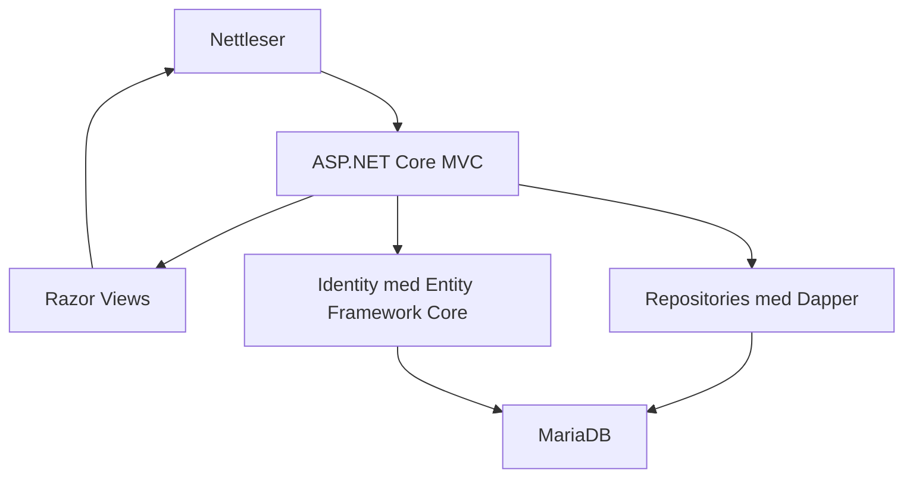

# IS-202 Programmeringsprosjekt

# Brukere og passord til innlogging / testing:

Brukere:
admin@kriseportal.local
orgadmin@kriseportal.local
behov@kriseportal.local
ressurs@kriseportal.local

Passord: DemoPass123

 
## Om prosjektet
Dette prosjektet er en ASP.NET Core MVC-applikasjon basert på caset om en ressurs- og behovsportal for Totalforsvaret. Formålet med løsningen er å støtte registreringen og delingen av informasjon om behov og ressurser under krise og større hendelser.
Applikasjonen støtter registrering, visning, redigering og sletting av behov og ressurser, med databaselagring, brukerinnlogging, tilgangskontroll og kartvisning.

 
## Teknologier
| Teknologi | Bruk i prosjektet |
|---|---|
| ASP.NET Core MVC | Rammeverk for webapplikasjonen. |
| C# | Programmeringsspråk for backend. |
| Razor Views | Brukes til å lage og vise nettsidene. |
| JavaScript | Brukes til interaksjon med Leaflet-kartet. |
| Bootstrap | Brukes til styling og responsivt design. |
| Leaflet | Brukes til kart og geografiske koordinater. |
| Docker | Kjører applikasjonen og MariaDB i separate containere. |
| Git | Brukes til versjonskontroll. |
| GitHub | Brukes til lagring av Git-repository og samarbeid i gruppen. |
| MariaDB | Lagrer behov, ressurser, matcher og brukeropplysninger. |
| Dapper | Utfører SQL-spørringer og kobler resultater til C#-objekter i repositoryene. |
| Entity Framework Core | Håndterer databasetilgang og migrasjoner for Identity-tabellene. |
| ASP.NET Core Identity | Håndterer brukere, passord, innlogging og roller. |
| Leaflet Draw | Lar brukeren tegne, redigere og slette punkter og linjer på kartet. |
| Docker Compose | Starter og konfigurerer applikasjonen og databasen sammen. |
| xUnit | Testrammeverk for enhetstestene. |
| Moq | Simulerer repositories slik at controllerne kan testes uten en ekte database. |


## Drift
Prosjektet er en ASP.NET Core MVC-applikasjon som kan kjøres i Docker. Prosjektet inneholder en Dockerfile og en compose.yml som brukes til å bygge og starte applikasjonen. Vi bruker Git til versjonskontroll og GitHub til å dele prosjektet og samarbeide i gruppen. Git registrerer endringer i koden gjennom commits. Dette gjør det mulig for oss å følge utviklingen og se hvem som har gjort endringer og hente frem tidligere versjoner ved behov. 
 
**Krav**
For å kjøre prosjektet trenger man Git og Docker installert. Repositoryet kan klones fra GitHub, og applikasjonen startes fra mappen som inneholder compose.yml.
 
**Kommando for å starte applikasjonen:**
```bash
docker compose up --build
```

Når containeren er startet, er applikasjonen tilgjengelig på http://localhost:8080. 
**Applikasjonen kan stoppes med:**
```bash
docker compose down
```

## Organisasjoner og brukerroller

Løsningen støtter organisasjonstilknytning for brukere. En organisasjon kan registreres og må godkjennes av en systemadministrator før den kan benyttes til administrasjon av ansatte.

Systemadministrator kan godkjenne organisasjoner, konfigurere tillatt e-postdomene og tildele rollen `OrganizationAdmin` til en bruker i organisasjonen.

Organisasjonsadministrator kan administrere ansatte i egen organisasjon og sende invitasjoner til nye ansatte.

En ansatt som registrerer seg gjennom en gyldig invitasjon, knyttes til riktig organisasjon og får rollen `Behovsaktør`.

### Invitasjoner til ansatte

Invitasjonsfunksjonen brukes til å opprette nye ansatte på en kontrollert måte.

1. Organisasjonsadministrator sender en invitasjon til en e-postadresse.
2. Systemet kontrollerer at e-postadressen tilhører organisasjonens tillatte e-postdomene.
3. Invitasjonen sendes på e-post med en unik registreringslenke.
4. Mottakeren åpner lenken og registrerer en ny brukerkonto.
5. Kontoen knyttes til organisasjonen og får rollen `Behovsaktør`.

Invitasjoner har begrenset gyldighetstid og kan tilbakekalles av organisasjonsadministrator. En invitasjon som allerede er brukt, utløpt eller tilbakekalt, kan ikke benyttes til registrering.

Invitasjonstoken lagres som en hash i databasen, slik at selve tokenverdien ikke lagres i klartekst.

### E-post og lokal testing

Ved lokal utvikling brukes Mailpit til å motta og kontrollere invitasjons-e-poster uten å sende dem til virkelige mottakere.

I utviklingsmiljøet `publicactor-dev` er Mailpit tilgjengelig på:

`http://localhost:8025`

### Tilgangskontroll

Løsningen bruker ASP.NET Core Identity for autentisering og rollebasert autorisasjon.

Behovsaktører kan registrere behov, mens ressurseiere kan registrere ressurser. Organisasjonsadministratorer kan administrere ansatte og invitasjoner innenfor egen organisasjon.

Tilgang kontrolleres på serversiden. Det er derfor ikke tilstrekkelig å kjenne URL-en til en funksjon man ikke har rettigheter til å bruke.

### Lokalt utviklingsmiljø med Docker Compose

Prosjektet bruker én felles Docker Compose-fil, `SemesterProsjekt/compose.yml`, for lokal utvikling og testing.

Oppsettet starter tre tjenester: ASP.NET Core-applikasjonen, MariaDB og Mailpit. Mailpit brukes til å teste invitasjons-e-poster uten å sende e-post til virkelige mottakere.

Fra mappen `SemesterProsjekt` startes løsningen med:

```bash
docker compose up --build -d
```

Tjenestene er tilgjengelige på:

| Tjeneste | Adresse |
|---|---|
| Applikasjon | http://localhost:8080 |
| Mailpit | http://localhost:8025 |
| MariaDB | localhost:3308 |

Demobrukere opprettes når `LocalDemo:Enabled` er aktivert. Dette er kun beregnet for lokal testing.

For å stoppe miljøet uten å slette databasedata:

```bash
docker compose down
```

MariaDB-data og applikasjonens Data Protection-nøkler lagres i Docker-volumer. Ikke bruk `docker compose down -v` dersom dataene skal beholdes.

Invitasjonslenker peker til `http://localhost:8080`, og invitasjons-e-poster kan leses i Mailpit på port 8025.

Dette oppsettet er beregnet for lokal utvikling og demonstrasjon, ikke produksjonsdrift.
## Systemarkitektur

Applikasjonen bruker ASP.NET Core MVC (Model-View-Controller).
Løsningen skiller mellom brukergrensesnitt, behandling av forespørsler
og tilgang til databasen. Applikasjonen og MariaDB kjører i hver sin
Docker-container og startes sammen med Docker Compose.

| Del | Ansvar i prosjektet |
|---|---|
| Controllers | `NeedController` og `ResourceController` håndterer visning, registrering, redigering og sletting av behov og ressurser. |
| Models | `Need` og `Resource` representerer behov og ressurser som hentes fra eller lagres i databasen. |
| ViewModels | `NeedViewModel` og `ResourceViewModel` inneholder skjemadata og valideringsregler. |
| Razor Views | Lager HTML-sidene som viser skjemaer, oversikter, detaljer og bekreftelser. |
| Repositories | Samler databasetilgangen bak interfaces som `INeedRepository` og `IResourceRepository`. Implementasjonene bruker Dapper og SQL. |
| ASP.NET Core Identity | Håndterer brukere, passord og roller. Identity bruker Entity Framework Core gjennom `ApplicationDbContext`. |
| MariaDB | Lagrer blant annet behov, ressurser, koblinger mellom dem og brukeropplysninger. |
| Leaflet og JavaScript | Håndterer kartvisning og registrering av geografiske punkter og linjer. |
| Docker Compose | Konfigurerer og starter applikasjonen og databasen, med nettverk og lagringsvolumer. |

### Sammenheng mellom komponentene



Controllerne mottar repositories gjennom dependency injection.
Dette betyr at ASP.NET Core leverer objektene controllerne trenger,
basert på registreringene i `Program.cs`. Controllerne trenger derfor
ikke å opprette databaseforbindelser eller skrive SQL selv.
I enhetstestene kan repositories erstattes med simulerte objekter.

### Dataflyt ved registrering

1. Brukeren åpner registreringsskjemaet. Controllerens GET-metode
   oppretter en ViewModel og henter tilgjengelige behovs- eller ressurstyper.
2. Brukeren fyller ut skjemaet og velger plassering på kartet.
3. Skjemaet sendes som en POST-forespørsel, og feltene bindes til en ViewModel.
4. Controlleren kontrollerer `ModelState`. Ved feil vises skjemaet igjen.
5. Ved gyldige data opprettes en `Need` eller `Resource`.
   Eierens bruker-ID hentes fra den innloggede brukeren.
6. Repositoryet lagrer registreringen i MariaDB og returnerer den nye ID-en.
7. Controlleren videresender til `Result`, som henter registreringen
   og viser en bekreftelsesside.

### Kartdata

Kartet bruker Leaflet og Leaflet Draw. Brukeren kan velge et punkt
eller tegne en linje. JavaScript overfører geometritypen til
`GeometryType` og geografien som GeoJSON til `GeometryData`.
Disse feltene sendes med skjemaet og lagres sammen med registreringen.

### Innlogging og tilgang

Behovs- og ressurscontrollerne krever innlogging. Handlinger som
oppretting, redigering og sletting har i tillegg rollekontroll.
Ved redigering og sletting kontrolleres det også at brukeren eier
registreringen eller er administrator.

POST-metodene for disse endringene bruker
`ValidateAntiForgeryToken` som beskyttelse mot forfalskede
forespørsler fra andre nettsteder.

### Database og oppstart

Domenedata håndteres gjennom repositories med Dapper.
Identity-tabellene håndteres gjennom Entity Framework Core.
Ved oppstart kjøres Identity-migrasjoner, opprettelse av roller
og `DomainSchemaMigrator`, som tilpasser eldre domenetabeller.

Docker Compose monterer `Database/init.sql` for initialisering av
en ny database. Databasefilene lagres i volumet `mariadb_data`,
mens applikasjonens Data Protection-nøkler lagres i
`dataprotection_keys`.

Applikasjonen er tilgjengelig på port 8080 på vertsmaskinen.
MariaDB er tilgjengelig på port 3308 fra vertsmaskinen, mens
applikasjonen bruker tjenestenavnet `mariadb` og port 3306
internt mellom containerne.

### Databasens fagtabeller

`Database/init.sql` oppretter følgende fem fagtabeller:

| Tabell | Innhold |
|---|---|
| `NeedType` | Kategorier for behov. |
| `ResourceType` | Kategorier for ressurser. |
| `Needs` | Registrerte behov med eier-ID, kartgeometri, status og prioritet. |
| `Resources` | Registrerte ressurser med eier-ID, kartgeometri og tilgjengelighet. |
| `Match` | Koblinger mellom behov og ressurser, med status, tidspunkt og merknader. |

Behov og ressurser er knyttet til sine kategorier gjennom
fremmednøkler. `Match` kobler behov og ressurser i en
mange-til-mange-relasjon: Ett behov kan kobles til flere ressurser,
og én ressurs kan kobles til flere behov.

Kombinasjonen av `NeedId` og `ResourceId` er unik i `Match`.
Dersom et behov eller en ressurs slettes, slettes tilhørende
matcher automatisk gjennom `ON DELETE CASCADE`.

`UserId` i `Needs` og `Resources` lagrer brukerens Identity-ID.
`init.sql` definerer ikke fremmednøkler fra disse feltene til
`AspNetUsers`.

Filen legger også inn faste behovs- og ressurstyper.
`INSERT IGNORE` gjør at eksisterende typer med samme ID eller
unike navn ikke settes inn på nytt.

Docker kjører `init.sql` ved første initialisering av en tom
database. Endringer i filen oppdaterer derfor ikke automatisk
en eksisterende database. `CREATE TABLE IF NOT EXISTS`
oppretter manglende tabeller, men endrer ikke eksisterende
tabellstrukturer.


## Testscenarioer og resultater
Applikasjonen er testet gjennom både enhetstester og manuelle tester. Enhetstestene brukes til å kontrollere deler av controller-funksjonaliteten, og de manuelle testene brukes til å kontrollere funksjonaliteter i applikasjonen som brukeren møter. For hver test dokumenteres det forventede resultatet og det faktiske resultatet.

### Enhetstester

Enhetstestene ligger i prosjektet `SemesterProsjekt.UnitTests`.
Vi bruker xUnit som testrammeverk og Moq til å simulere repositories.
Testene kontrollerer dermed controllerlogikken uten å koble til
en ekte database.

Testene følger Arrange–Act–Assert:
- **Arrange:** Opprette testdata, simulert repository og eventuelt en testbruker.
- **Act:** Kalle controller-metoden som skal testes.
- **Assert:** Kontrollere resultatet og hvilke repository-metoder som ble kalt.

Metodene som testes er asynkrone. Testene bruker derfor `async`
og `await` for å undersøke det ferdige resultatet.

**Resultat fra gruppens bekreftede testkjøring 4. november 2026:
9 av 9 enhetstester bestått.**

| # | Testmetode | Forventet resultat | Resultat |
|---|---|---|---|
| 1 | `Need_Get_ReturnsViewWithNeedViewModel` | GET `Create()` returnerer `ViewResult` med `NeedViewModel`. | Bestått |
| 2 | `Need_Post_RedirectsToResult` | Videresender til `Result` med ID 1. Repositoryets `CreateAsync` kalles én gang med forventet bruker-ID og tittel. | Bestått |
| 3 | `Resource_Get_ReturnsViewWithResourceViewModel` | GET `Create()` returnerer `ViewResult` med `ResourceViewModel`. | Bestått |
| 4 | `Resource_Post_RedirectsToResult` | Videresender til `Result` med ID 1. Repositoryets `CreateAsync` kalles én gang med forventet bruker-ID og tittel. | Bestått |
| 5 | `NeedGet_ShouldNotReturnResourceViewModel` | GET `Create()` returnerer et view der modellen ikke er en `ResourceViewModel`. | Bestått |
| 6 | `ResourcePost_InvalidModel_ReturnsViewWithoutSaving` | Ved feil i `ModelState` returneres samme modell til viewet, og `CreateAsync` kalles ikke. | Bestått |
| 7 | `DeleteConfirmed_OtherUsersResource_ReturnsForbid` | En bruker som ikke er eier eller administrator får `ForbidResult`. `DeleteAsync` kalles ikke. | Bestått |
| 8 | `DeleteConfirmed_OwnResource_DeletesAndRedirects` | Eieren får slettet ressursen gjennom ett kall til `DeleteAsync(1)` og videresendes til `Overview`. | Bestått |
| 9 | `DeleteConfirmed_MissingResource_ReturnsNotFound` | En ressurs som ikke finnes gir `NotFoundResult`. `DeleteAsync` kalles ikke. | Bestått |

### Hva testene kontrollerer

**Visning av skjemaer**

GET-testene kontrollerer at controllerne returnerer riktig
resultattype og ViewModel. Testen `NeedGet_ShouldNotReturnResourceViewModel`
kontrollerer at behovsskjemaet ikke mottar ressursmodellen.
Dette er en test som skal bestå, ikke en bevisst feilende test.

**Registrering av behov og ressurser**

POST-testene oppretter en simulert innlogget bruker med ID-en
`testbruker-1`. Repositoryet konfigureres til å returnere ID 1
ved opprettelse. Testene kontrollerer videresendingen og at
objektet som sendes til repositoryet har riktig eier og tittel.

**Ugyldige skjemadata**

Testen for ugyldig ressursregistrering legger manuelt en feil
i `ModelState`. Den kontrollerer at controlleren viser skjemaet
igjen uten å kalle lagringsmetoden.

**Sletting og eierskap**

De tre slettetestene kontrollerer at en annen bruker blir avvist,
at eieren kan slette, og at en manglende ressurs håndteres.
`Times.Once` og `Times.Never` brukes for å kontrollere om
repositoryets slettemetode blir kalt.

### Avgrensning av enhetstestene

Testene kaller controller-metodene direkte. De tester ikke ekte
databaseoperasjoner, rendering av HTML eller hele innloggingsflyten.

Autorisasjonsfiltre og antiforgery-validering kjøres ikke ved slike
direkte metodekall. Slettetestene kontrollerer eierskapskontrollen
inne i metoden, men dokumenterer ikke alene at hele tilgangskontrollen
fungerer gjennom HTTP.

Automatisk skjemavalidering fra MVC kjøres heller ikke ved direkte
metodekall. Testen for ugyldige data simulerer derfor en valideringsfeil
ved å legge den til i `ModelState`.

### Kjøre enhetstestene

Fra repositoryets rotmappe kjøres:

```bash
dotnet test SemesterProsjekt.UnitTests/SemesterProsjekt.UnitTests.csproj
```

Dette krever .NET SDK 10. Testene kan også kjøres gjennom
testverktøyet i Rider.

### Utvidet testing av organisasjoner og invitasjoner

Ved videreutvikling av `NyLøsning/PublicActor` er testdekningen utvidet med tester for organisasjonstilknytning, invitasjoner, tilgangskontroll og databaseoperasjoner.

**Resultat fra siste automatiserte testkjøring: 67 av 67 tester bestått.**

Testene omfatter både enhetstester og integrasjonstester mot MariaDB, blant annet kontroll av registrering via invitasjoner, rolletildeling og tilbakerulling av databasetransaksjoner ved feil.

I tillegg er følgende funksjoner kontrollert manuelt i Docker-miljøet:

| Test | Forventet resultat | Resultat |
|---|---|---|
| Behovsaktør registrerer behov | Behovet lagres og vises i oversikten | Bestått |
| Ressurseier registrerer ressurs | Ressursen lagres og vises i oversikten | Bestått |
| Matching | Behov og ressurs kan matches | Bestått |
| Rollebasert tilgang | Behovsaktør og Ressurseier blokkeres fra hverandres registreringsfunksjoner | Bestått |
| Invitasjon til ansatt | Organisasjonsadministrator kan sende invitasjon via Mailpit | Bestått |
| Registrering via invitasjon | Ansatt opprettes i riktig organisasjon med rollen `Behovsaktør` | Bestått |
| Gjenbruk av invitasjon | En brukt invitasjon avvises | Bestått |
| Tilbakekalling | En tilbakekalt invitasjon avvises | Bestått |
| Feil e-postdomene | Invitasjon til en adresse utenfor organisasjonens tillatte domene avvises | Bestått |

Testene ble gjennomført etter at oppdateringer fra `main` ble slått sammen med `NyLøsning/PublicActor`.

### Manuelle tester
I tillegg til enhetstestene har vi gjennomført manuelle tester av applikasjonen. Dette gjorde vi for å kontrollere funksjonalitet som brukeren møter i nettleseren. Testene ble gjennomført ved å bruke applikasjonen som en vanlig bruker og sammenligne det forventede resultatet med det faktiske resultatet.

| # | Test | Tidligere forventet resultat | Resultat |
|---|---|---|---|
| 1 | Åpne startsiden | Startsiden vises og brukeren kan velge behov og ressurs | Bestått |
| 2 | Registrere behov | Utfylt behov vises på resultatsiden | Bestått |
| 3 | Velge posisjon på kart | Markør vises og latitude/longitude fylles inn | Bestått |
| 4 | Registrere ressurs | Utfylt ressurs og koordinater vises på resultatsiden | Bestått |
| 5 | Mobilvisning 400 px bredde | Navigasjon, skjema, resultatsider og kart tilpasser seg skjermbredden uten feil | Bestått |

### Systemtesting

| ID | Test og fremgangsmåte | Forventet resultat | Status |
|---|---|---|---|
| SYS-01 | Registrer en ny bruker med en ubrukt e-postadresse. Logg ut og logg inn igjen. | Brukeren opprettes og kan logge inn med de registrerte opplysningene. | Bestått |
| SYS-02 | Logg inn som ressurseier. Opprett en ressurs med gyldige felt og et punkt på kartet. | Ressursen lagres og vises i ressursoversikten. | Betstått | 
| SYS-03 | Åpne den opprettede ressursen og oppdater nettlesersiden. | Opplysningene og kartpunktet vises fortsatt riktig. | Bestått |
| SYS-04 | Rediger tittelen på din egen ressurs. Lagre og åpne ressursen på nytt. | Den nye tittelen vises og er lagret. | Bestått |
| SYS-05 | Slett en egen testressurs og oppdater oversikten. | Ressursen er fjernet fra oversikten og er ikke lenger tilgjengelig på detaljsiden. | Bestått |
| SYS-06 | Send inn ressursskjemaet uten et obligatorisk felt. | En forståelig valideringsmelding vises, og ressursen blir ikke lagret. | Bestått |

### Sikkerhetstesting

| ID | Test og fremgangsmåte | Forventet resultat | Status |
|---|---|---|---|
| SIK-01 | Logg ut og åpne /Resource/Create direkte. | Brukeren sendes til innlogging og får ikke tilgang til skjemaet. | Bestått | 
| SIK-02 | Opprett en ressurs med bruker A. Kopier redigeringsadressen. Logg inn som bruker B og åpne adressen. | Bruker B får avslag og kan ikke redigere ressursen. | Bestått |
| SIK-03 | Kopier sletteadressen til bruker A sin testressurs. Åpne den som bruker B. | Bruker B får avslag. Ressursen finnes fortsatt når bruker A kontrollerer den. | bestått |
| SIK-04 | Forsøk å logge inn med riktig e-postadresse og feil passord. | Innlogging avvises med en forståelig feilmelding. | Bestått |
| SIK-05 | Bruk en egen testkonto og skriv feil passord fem ganger. Prøv deretter riktig passord. | Kontoen blir midlertidig låst i henhold til innstillingene i appen. | Bestått |


### Mobil- og brukervennlighetstesting

| ID | Oppgave | Forventet resultat | Observasjon |Status |
|---|---|---|---|---|
| BRU-01 | Opprett en testressurs og plasser et punkt på kartet med berøring. | Skjema og kart kan brukes på mobil, og ressursen lagres med riktig punkt. | kartet kan være litt vanskelig å bruke mtp at man må velge "plasser på kart knappen" | Bestått |
| BRU-02 | La en person som ikke har laget siden finne og opprette en ressurs uten veiledning. | Personen klarer oppgaven og forstår feltene og knappene. | Litt mer synelig registrer ressurs og lettere å plassere på kart| Bestått |
| BRU-03 | Be testpersonen finne og redigere ressursen de nettopp opprettet. | Personen finner funksjonen og forstår om endringen ble lagret. | gjerne gjøre at en ressursleverandør bare kan se egne ressurser | Bestått|


## Dokumentasjon i koden
Vi bruker korte kommentarer på sentrale klasser og metoder for å forklare hva koden gjør. Fokuset ligger spesielt på controller-metodene og ViewModel-klassene. Dokumentasjonen i koden er kort og forklarer hensikten med sentrale deler av løsningen, og forklarer ikke hver enkelt linje.

## Bruk av KI i prosjektet
I dette prosjektet har vi hovedsakelig brukt KI-verktøyet ChatGPT som et hjelpemiddel i utviklingen. KI har i hovedsak blitt brukt til korreksjon av syntaksfeil, rydde opp i og forkorte unødvendig kode, og gi forslag til hvordan koden kan bli bedre strukturert. I tillegg har vi brukt KI for å få bedre forståelse av enkelte konsepter underveis. Løsninger og faglige vurderinger i prosjektet er våre egne.

### Eksempler på prompts før første innlevering
- "Kan dette sammenlignes med OOP i C#? Om det går, forklar i mens du sammenligner"
- "Forklar hvordan Model, View og Controller fungerer i MVC, og hvordan de henger sammen"
- "Kan du forklare GitHub-workflows? Steg for steg slik vi jobber mest mulig effektivt og unngår konflikt"
- "Kan du vise hvordan jeg kan konvertere tabellene fra google docs dokumentet slik det ser riktig ut i README-filen?"
- "Hva er feil her? Hvorfor er det grå farge i teksten på Rider?"
- "Skal enhetstestene ligge i samme fil som applikasjonen? Eller i samme prosjekt-mappe som applikasjonen?"

### Bruk av KI fra første til andre innlevering

I denne perioden har vi brukt KI som støtte til å forstå hvordan vi kan anvende fagstoff fra forelesningene i prosjektet. Vi har fått veiledning om aktuelle NuGet-pakker for ASP.NET Core Identity, hvordan Identity kan implementeres i applikasjonen, og hvordan migrasjoner brukes til å opprette og oppdatere databasetabellene for brukerhåndtering.

Vi har også brukt KI til å forstå hvordan `[Authorize]` kan brukes på controllere og enkelte metoder for å styre tilgangen til funksjonalitet. Dette omfattet innlogging og rollebasert tilgangskontroll.

Vi har brukt KI til veiledning og hjelp til å utvikle fungerende Razor-views basert på prototypen vi har laget i Figma.

Gjennom perioden har vi fortsatt å bruke KI til å forklare kode og konsepter fra forelesningene, og til å diskutere hvilke funksjoner og tekniske løsninger som var relevante å implementere i prosjektet.

### Eksempler på prompts fra første til andre innlevering, gjengitt med egne ord
- "Kan du forklare forskjellen mellom autentisering og autorisering?"
- "Vi har lært om ASP.NET Core Identity i forelesningen. Hvordan kan vi bruke dette til registrering og innlogging i prosjektet vårt?"
- "Hvilke NuGet-pakker trenger vi for å bruke ASP.NET Core Identity i prosjektet? Hva gjør de ulike pakkene? Og har det noe å si hvilken versjon de er i?"
- "Vi har laget tabeller med dapper fra før av, kan vi fortsatt bruke Microsoft Asp.Net Core Identity for implementering av roller/brukere?"


